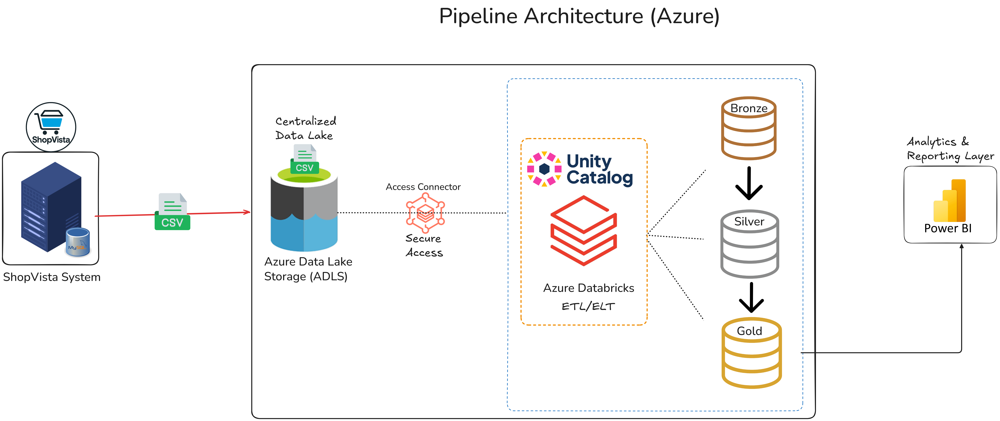
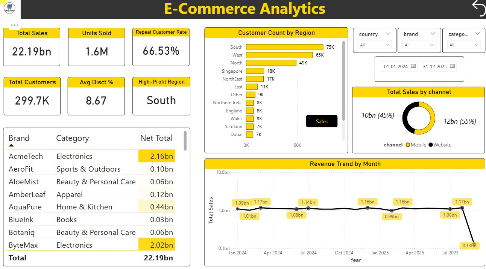

# ShopVista Ecommerce Data Engineering Project

An end-to-end ecommerce analytics project built with Databricks, Apache Spark, PySpark, Delta Lake, Unity Catalog, and Azure Data Lake Storage Gen2. The project follows a medallion architecture and includes a Power BI dashboard for reporting.

## Architecture



The pipeline ingests ecommerce data into Azure Data Lake Storage, creates an external volume in Unity Catalog, and transforms the data through Bronze, Silver, and Gold layers.

```text
ADLS Gen2 / Raw CSV Files
           |
           v
      Bronze Tables
           |
           v
      Silver Tables
           |
           v
      Gold Tables
           |
           v
      Power BI
```

## Dashboard



The Power BI report is available in [4_dashboarding/ecommerce_analytics.pbix](4_dashboarding/ecommerce_analytics.pbix).

## Technologies Used

- Azure Data Lake Storage Gen2
- Azure Databricks
- Apache Spark and PySpark
- Delta Lake
- Databricks Unity Catalog
- Structured Streaming
- SQL
- Power BI
- Python

## Project Structure

```text
1_setup/                        Unity Catalog and external volume setup
2_medallion_processing_dim/     Dimension tables: Bronze to Silver to Gold
3_medallion_processing_fact/    Fact tables: Bronze to Silver to Gold
4_dashboarding/                 Power BI dashboard
resources/                      Architecture and report images
```

## Data Model

### Dimension Data

- Brands
- Categories
- Products
- Customers
- Date / calendar

### Fact Data

- Order items
- Daily order summary

The gold layer contains BI-ready dimension and fact tables, including:

- `gld_dim_products`
- `gld_dim_customers`
- `gld_dim_date`
- `gld_fact_order_items`
- `gld_fact_daily_orders_summary`

The Bronze and Silver layers include the corresponding dimension tables for brands, categories, products, customers, and the calendar.

## Pipeline Processing

### 1. Setup

Run the notebooks in `1_setup/` to:

- Create the `ecommerce` Unity Catalog catalog
- Create the `raw`, `bronze`, `silver`, and `gold` schemas
- Configure an external volume for raw ADLS Gen2 data

### 2. Dimension Tables

Process dimension data in this order:

1. `2_medallion_processing_dim/1_dim_bronze.ipynb`
2. `2_medallion_processing_dim/2_dim_silver.ipynb`
3. `2_medallion_processing_dim/3_dim_gold.ipynb`

The dimension pipeline applies schemas, adds ingestion metadata, cleans values, standardizes regions and states, and creates BI-ready tables.

### 3. Fact Tables

Process fact data in this order:

1. `3_medallion_processing_fact/1_fact_bronze.ipynb`
2. `3_medallion_processing_fact/2_fact_silver.ipynb`
3. `3_medallion_processing_fact/3_fact_gold.ipynb`
4. `3_medallion_processing_fact/4_daily_summary.ipynb`

The fact pipeline uses Spark Structured Streaming, incremental processing, Delta change feeds, merge/upsert logic, and checkpoints.

## Running the Project

1. Create an Azure Databricks workspace and an Azure Data Lake Storage Gen2 account.
2. Upload the contents of `0_data/ecomm-raw-data/` to your ADLS Gen2 landing container.
3. Import the notebooks into a Databricks workspace.
4. Replace storage account, container, catalog, and volume locations with values from your environment.
5. Configure Unity Catalog permissions for the Databricks workspace and cluster.
6. Run the setup notebooks first.
7. Run dimension Bronze, Silver, and Gold notebooks.
8. Run fact Bronze, Silver, Gold, and daily-summary notebooks.
9. Open `ecommerce_analytics.pbix` in Power BI Desktop and connect it to the gold tables or reporting endpoint.

## Security and Configuration

Do not commit credentials, storage keys, SAS tokens, or personal configuration values to GitHub. Use Databricks secrets or environment-specific settings for sensitive values.

Before running, update hard-coded storage locations in the notebooks to match the ADLS Gen2 account and Unity Catalog configuration used in your Azure environment.

## Key Features

- Medallion architecture
- Unity Catalog integration
- Delta Lake tables
- Incremental fact ingestion
- Streaming data processing
- Delta MERGE upserts
- Schema evolution
- Checkpoint-based recovery
- Bronze, Silver, and Gold transformations
- BI-ready analytical tables
- Power BI reporting

## Author

Created as a Databricks and Azure ecommerce data engineering project.
